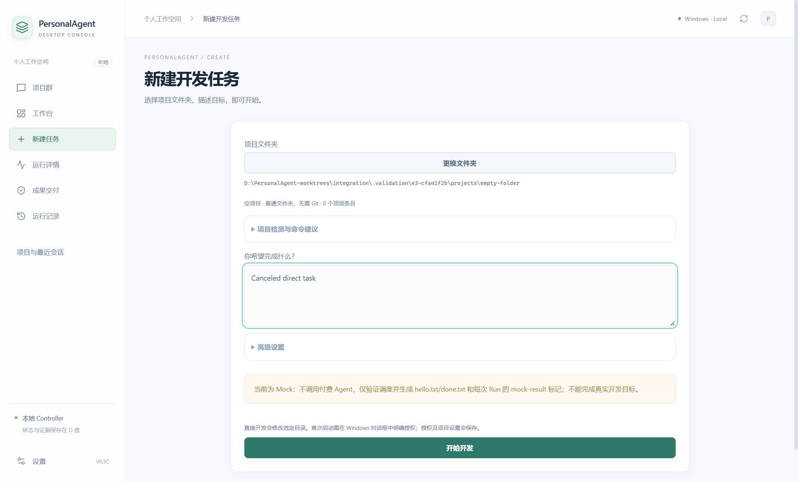
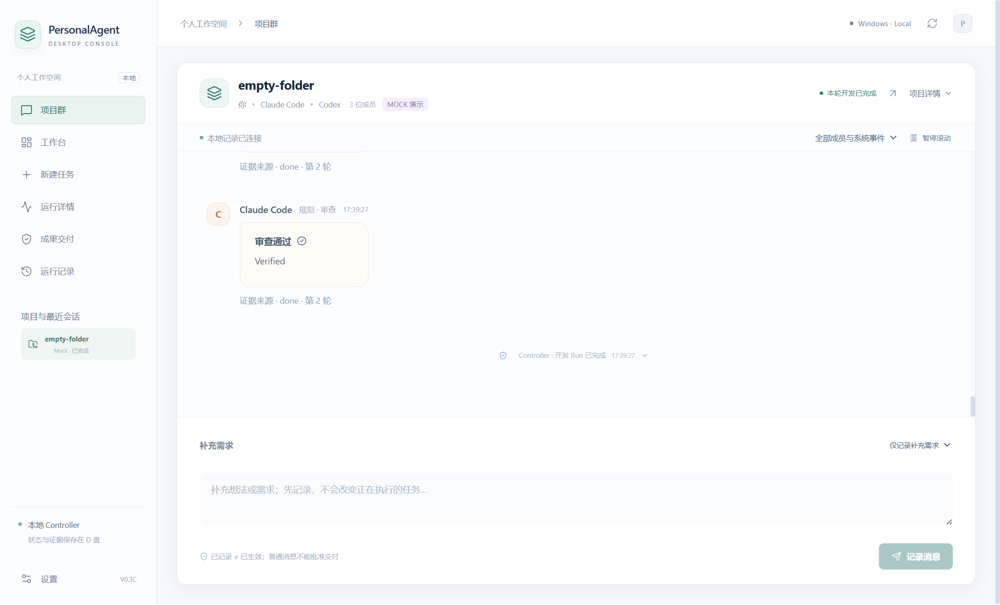
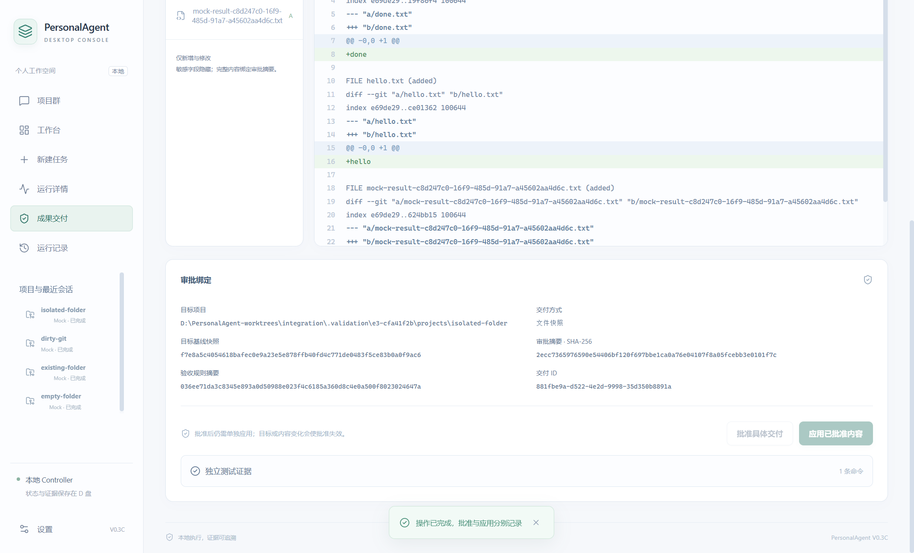
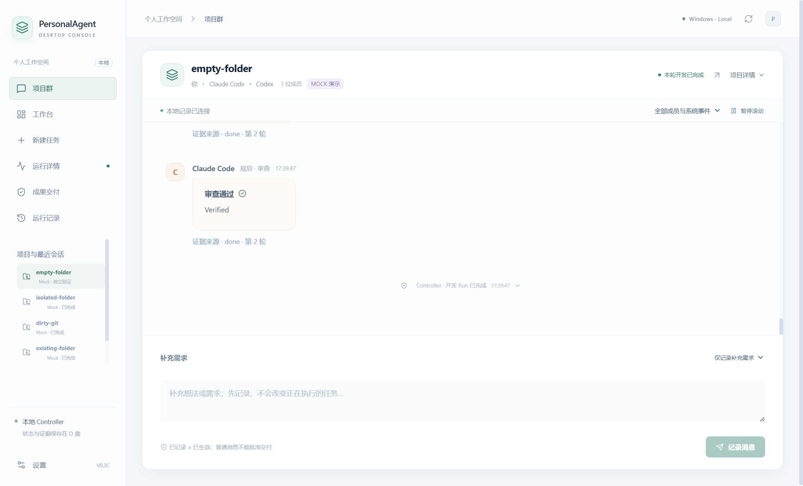
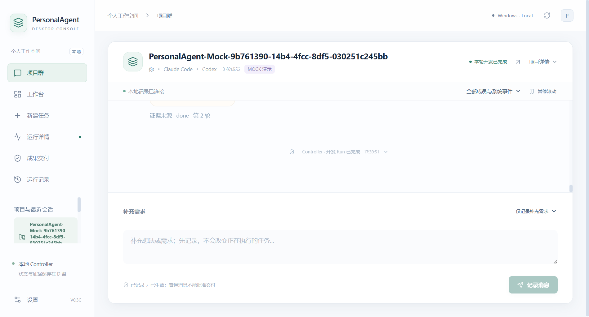
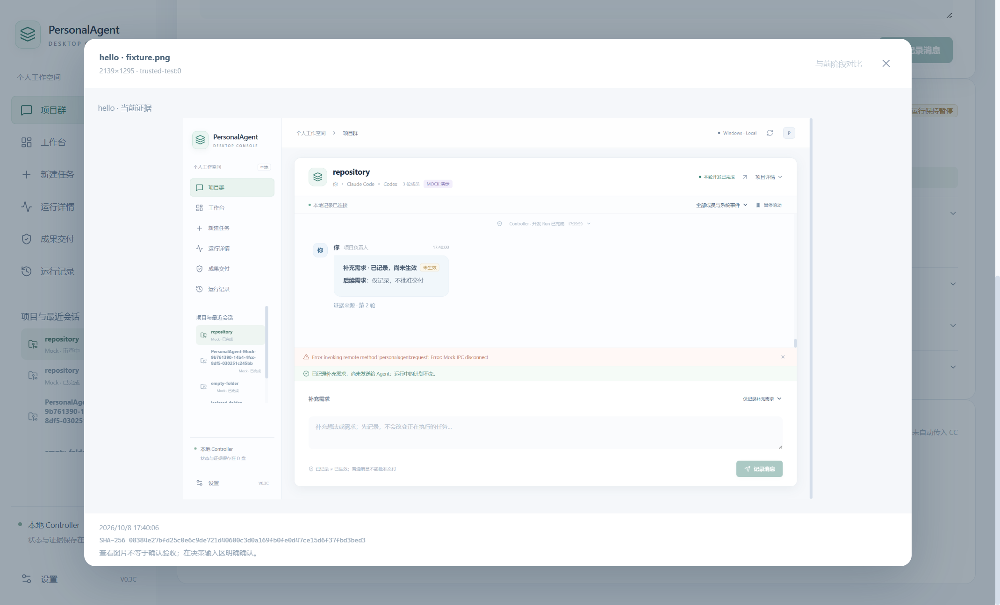

# PersonalAgent V0.3C.3 集成验收

验收日期：2026-10-08。交付位于 `D:\PersonalAgent-worktrees\integration`，分支 `codex/v03c-integration`。本组两个开发任务分别使用 `D:\PersonalAgent-worktrees\v03c2` 和 `D:\PersonalAgent-worktrees\v03c3`；在第三个 Worktree 逐项 cherry-pick 集成，未合并 main、未推送、未发布。

## 结论与证据范围

GUI 已真正接入原有 Controller 的普通目录执行能力。用户可以选择文件夹、输入目标、点击开始，无需导入 Controller 配置、编写 JSON、提交 Git 或准备 CLI 命令。空文件夹、已有普通项目、含未提交修改的 Git 项目、C 盘普通项目均已通过实际文件变化与独立 Mock 标记检查。

真实 CC/Codex 原生适配已接入，保留本机工具、配置和会话续接。原生工具参数、公开事件、两角色文件修改以及 Controller 再验收已有本地注入测试；没有调用真实付费服务，不能据此宣称真实模型、所有 hooks、Skills、MCP 或网络工具均已实测。GUI 默认 Mock，并明确说明 Mock 只生成 hello.txt、done.txt 和每次 Run 专属的 mock-result 标记，不能完成用户真实开发目标。

## 普通用户操作流程

1. 双击本集成目录的 [PersonalAgent.cmd](PersonalAgent.cmd)。当前集成版已构建，可直接打开。
2. 点击“新建任务”，再点击“选择项目文件夹”。Windows 原生选择器可以选择或创建文件夹；无需 Git。
3. 输入自然语言目标，点击“开始开发”。首次直接开发会弹出明确修改目录的授权；取消不会创建 Run 或修改文件。
4. 需要真实开发时展开高级设置，将 Mock 改为真实 Claude Code / Codex，确认本次调用额度。这里也可选择隔离模式、调用预算和检测到的独立测试命令。模型沿用本机默认值。
5. 启动后自动进入原有三人项目群。状态、任务依赖、测试、审查、预算与会话由 Controller 管理；普通聊天备注仍是待生效消息，不会自动批准交付。
6. 再次打开项目可使用“最近项目”；已确认的直接授权、预算和工作模式可复用。隔离模式完成后，从成果交付页预览、批准、应用；普通文件夹不要求输入 Git 分支。

真实项目没有独立测试命令时可以启动和开发，但 Controller 会暂停并明确需要人工验证，不会自动标记项目验收通过。空项目首次创建的测试如何进入后续可信验收，仍需在下一次配置或高级导入中明确；本次没有用文件存在性检查冒充项目正确性验收。

## 实际回归结果

| 验收 | 命令 | 结果 |
| --- | --- | --- |
| Controller 构建与全部回归 | `npm test` | 131/131 通过 |
| GUI 构建 | `npm run build --prefix desktop` | 通过 |
| GUI 类型检查 | `npm run check --prefix desktop` | 通过 |
| GUI service/thread 全部回归 | `npm test --prefix desktop` | 31/31 通过 |
| 实际 Electron 操作与截图 | `node desktop/validate-v03c3.mjs` | 11/11 组通过，Renderer 错误 0 |
| 真实付费 Agent 调用 | 无 | 0 |

完整日志、截图与 SHA-256 清单保存在 [desktop/validation-v03c3](desktop/validation-v03c3/evidence.json)。Electron 使用实际 Electron 主进程、Renderer、IPC、Controller 子进程和文件系统；仅将原生文件夹选择及确认对话框的返回值替换为确定性测试选择/批准/取消。没有把对话框自动化替身称为实际人工点击 Windows 系统选择器。

Electron 验证：取消选择和直接修改授权；无 Git 空项目；已有普通项目原文件保留；dirty Git 的未提交内容与原提交数保留；普通文件夹隔离执行且审批前源项目不变、通过 GUI 分别批准和应用；最近项目与重启恢复、Run 不重复；1280 布局；C 盘项目与 D 盘内部数据；旧 Git 隔离 Mock；角色筛选与待生效备注；IPC 断连/重连；可信截图放大与明确视觉确认后续接。新项目启动和普通文件夹隔离交付均通过真实界面操作，未手写配置或执行 Git 命令。

## 两种模式及兼容性

- 直接开发：`source` 和 `workspace` 指向同一真实项目目录，文件即时生效；首次授权按真实路径持久化，不与真实付费确认或隔离交付审批混用。直接 Run 拒绝再次 preview/apply 成果。
- 隔离开发：非 Git 项目采用真实文件复制和外部快照，不初始化伪装 Git。Git 项目保留独立 clone、原 HEAD、未提交修改、删除及未跟踪文件；运行不修改源项目。交付仍使用原有 preview/approve/apply，有目标后续修改则拒绝覆盖。
- 旧配置未指定 `workspaceMode` 时保留原 Git 隔离行为；旧 proposal、历史 State、预算、审计、依赖、会话、正式审批继续通过回归。未将主目录真实游戏 Run 或交付数据写入本次测试。
- 项目可以位于其他磁盘；配置、日志、快照、运行数据和跨 Run 项目锁仍位于 PersonalAgent 的 D 盘目录。
- 原生 Shell 权限可以访问其他目录；项目规则和工作目录不是操作系统级隔离。未把规则约束或隔离工作目录冒充技术沙箱。

## 集成时发现并修复的问题

旧 GUI 测试及构建缓存硬编码主目录，现已使用当前 Worktree。初期新 schema 放开空测试数组后，旧断言仍要求拒绝空数组；改为验证非法命令，另有无测试暂停用例。hardlink 诊断保持旧错误语义。新 Mock 增加每 Run 文件，避免最近项目再次运行因无新变更被误判。Windows 超长运行路径曾导致 ENOTCONN 崩溃，现缩短自动生成路径、明确拒绝超长 cwd，并把管道异常转为持久失败。普通文件夹交付移除强制 Git 分支输入，使用文件快照绑定审批。

## 尚未完成及残留限制

1. 真实付费 Agent 服务验收未执行。当前证明的是原生接口接入和本地协作闭环；真实账号认证、服务额度、扩展和网络能力仍待用户另行确认预算后验证。
2. 恢复已提供 Controller API/CLI：保存外部基线及停止/失败检查点，恢复前校验当前文件与检查点，拒绝覆盖后续人工修改并共用项目锁。GUI 尚无一键恢复入口；不能称普通用户恢复体验已经完成。文件系统也不是事务隔离，外部进程不受协作锁强制控制。
3. 准备快照上限为 100 MiB、20,000 文件；运行阶段单轮基线另有 50 MiB 上限。链接、特殊文件及空目录元数据尚不支持；依赖目录 node_modules 不复制，隔离模式可能需要原生 Agent 安装依赖。
4. 自动隔离交付仅支持 UTF-8 新增/修改，最多 50 个变更、总内容 2 MiB；删除和二进制交付需要人工处理。直接模式的实际二进制及删除可追踪，但仍受快照限制。
5. Windows 子进程 cwd 达到 260 字符会明确拒绝启动。缩短自动运行路径不能保证所有超长项目路径都可用。
6. 项目快照可能含敏感文件，存于本机 D 盘，未增加加密。没有扩大本次任务为另一套权限或加密系统。
7. 同机另一个“恢复 Claude Code 与 Codex 原生能力”聊天也在独立开发，使用 projectMode 契约。本聊天已提出跨聊天协调授权但未收到答复，未向该聊天发送指令或混入它的后续成果；本组两任务统一使用 workspaceMode，跨聊天分支尚未统一。不能将本次独立集成报告当作另一个聊天分支也已集成的证明。

## 实际 Electron 截图

新建任务普通界面：

无 Git 空项目直接开发完成：

普通文件夹隔离成果通过 GUI 单独批准、应用：

重启恢复最近项目与直接授权：

C 盘普通项目，内部数据仍在 D 盘：

旧群聊可信截图与正式决策回归：

